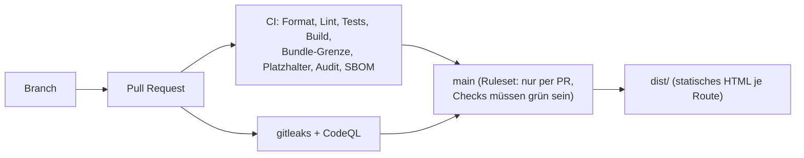

# philippklinger.com

[](https://github.com/PhilippKlinger/philippklinger.com/actions/workflows/ci.yml)
[](https://github.com/PhilippKlinger/philippklinger.com/actions/workflows/codeql.yml)

Portfolio-Website von Philipp Klinger (DevSecOps & Fullstack). Die Seite stellt Projekte mit Nachweisen vor und ist selbst ein Beleg: Jede Änderung läuft über Pull Request, automatische Prüfungen und einen nachvollziehbaren Build.

## Herkunft

**Neuaufbau 2026.** Die Vorgängerversion entstand in der Weiterbildung bei der Developer Akademie (Angular 16, Akademie-Vorlage) und ist über den Tag [`v1-legacy`](https://github.com/PhilippKlinger/philippklinger.com/tree/v1-legacy) erhalten.

Das Design basiert auf einer Portfolio-Vorlage der Developer Akademie GmbH, angepasst und erweitert.

**Eigener Beitrag:** Neuaufbau auf Angular 22 mit statischem Prerendering, eigene Seitenstruktur, Design-Tokens mit WCAG-AA-Kontrasten, Quality Gates in der CI und abgesicherter `main`-Branch.

## Stack

| Bereich   | Umsetzung                                                                                 |
| --------- | ----------------------------------------------------------------------------------------- |
| Framework | Angular 22, Standalone Components, zoneless                                               |
| Rendering | statisch vorgerendert (`outputMode: "static"`), kein Server zur Laufzeit                  |
| Styles    | SCSS mit Design-Tokens (Custom Properties), Schriften Fira Code und Karla selbst gehostet |
| Tests     | Vitest                                                                                    |
| Qualität  | ESLint, Prettier                                                                          |
| Hosting   | statischer Webspace (Apache)                                                              |

## Ablauf



Die Workflows liegen in [`.github/workflows/`](.github/workflows/). Das automatische Deployment auf den Webspace folgt.

## Lokal starten

Voraussetzung: Node.js 24 und npm.

| Zweck                                                 | Befehl                 |
| ----------------------------------------------------- | ---------------------- |
| Abhängigkeiten installieren                           | `npm ci`               |
| Entwicklungsserver (http://localhost:4200)            | `npm start`            |
| Unit-Tests                                            | `npm test`             |
| Lint                                                  | `npm run lint`         |
| Formatierung prüfen                                   | `npm run format:check` |
| Produktions-Build nach `dist/philippklinger/browser/` | `npm run build`        |

## Projektstruktur

```
src/
  app/pages/   eine Komponente je Seite (Start, Impressum, Datenschutz, 404)
  styles/      Design-Tokens, Breakpoints, Schriften, Basis-Styles
.github/       CI-Workflows und Dependabot
```
