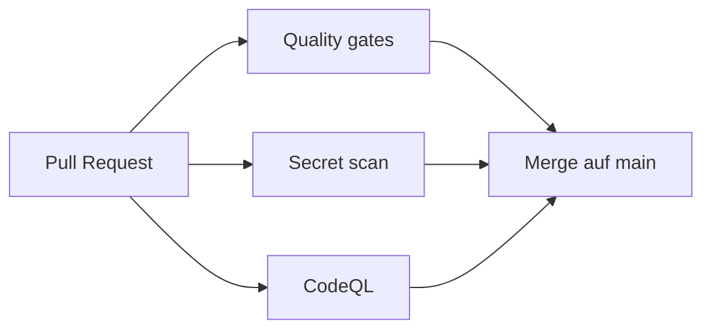

# Erklärung der CI-Workflows — philippklinger.com

> Jeden Schritt so erklären können, dass er im Gespräch trägt. Bei jeder Workflow-Änderung mitpflegen.

## Gesamtüberblick

Jeder Pull Request auf `main` durchläuft drei Prüfungen: `CI / Quality gates`, `CI / Secret scan` und `CodeQL`.
Ein direkter Push auf `main` ist per Ruleset gesperrt, Änderungen kommen nur über einen PR.
Die Seite ist statisch (Angular mit Prerendering). Es gibt kein Docker-Image, das Deployment per FTPS auf den Webspace folgt in Stufe 2.

## 1. ci.yml

### 1.1 Auslöser

Bei jedem PR auf `main` und bei jedem Push auf `main`, also nach dem Merge. So ist auch der Stand nach dem Merge geprüft.

### 1.2 Berechtigungen und parallele Läufe

- `permissions: contents: read` als Grundeinstellung: Der Workflow darf den Code lesen, sonst nichts.
- Nur der Job `secrets` darf zusätzlich PR-Kommentare schreiben, damit gitleaks Funde direkt am PR zeigen kann.
- `concurrency` bricht ältere Läufe desselben Branches ab, wenn ein neuer Commit kommt.
- `persist-credentials: false` verhindert, dass der Git-Token nach dem Checkout im Arbeitsverzeichnis liegen bleibt.

### 1.3 Job `quality`

| Schritt                        | Warum                                                                                                                                 |
| ------------------------------ | ------------------------------------------------------------------------------------------------------------------------------------- |
| `npm ci`                       | installiert exakt die Versionen aus `package-lock.json`                                                                               |
| Prettier, ESLint               | einheitlicher Stil, typische Fehler früh finden                                                                                       |
| Unit-Tests (Vitest)            | Verhalten absichern, zum Beispiel Seitentitel, eine `h1` je Seite, Skip-Link                                                          |
| Build                          | erzeugt die statischen HTML-Seiten je Route                                                                                           |
| Bundle-Größe                   | Das Startbundle darf höchstens 150 kB gzip haben. Angulars eigene Budgets messen nur unkomprimiert, deshalb misst der Schritt selbst  |
| Platzhalter-Check              | Fehlende Links zeigen auf `platzhalter.invalid`. Steht so ein Link im Build, schlägt der Lauf fehl, damit nichts Unfertiges live geht |
| `npm audit --audit-level=high` | bricht bei bekannten Lücken der Stufe hoch oder kritisch ab                                                                           |
| SBOM (CycloneDX)               | Stückliste der Laufzeit-Abhängigkeiten als Artefakt, damit nachvollziehbar ist, was ausgeliefert wird                                 |

### 1.4 Job `secrets`

gitleaks durchsucht die **ganze** Git-Historie (`fetch-depth: 0`) nach Schlüsseln und Passwörtern. Die volle Historie ist nötig, weil ein Secret auch in einem alten Commit gefunden werden muss, selbst wenn es später gelöscht wurde. Für Repos eines persönlichen Kontos braucht die Action keine Lizenz.

## 2. codeql.yml

CodeQL ist die statische Sicherheitsanalyse von GitHub. Sie prüft zwei Dinge:

- `javascript-typescript`: den Anwendungscode
- `actions`: die Workflow-Dateien selbst, zum Beispiel auf unsichere Verwendung von Eingaben

Sie läuft bei PRs, auf `main` und einmal pro Woche, weil neue Abfrageregeln auch alten Code betreffen können. Ergebnisse stehen unter _Security → Code scanning_.

## 3. dependabot.yml

Dependabot öffnet jede Woche PRs für neue Versionen:

- **npm-Pakete:** Angular und Entwickler-Werkzeuge jeweils gebündelt, damit nicht zwanzig Einzel-PRs entstehen
- **GitHub Actions:** Dependabot aktualisiert auch die SHA-Pins

## Die professionelle Kurz-Erklärung

Jeder Pull Request wird automatisch geprüft: auf Formatierung, Lint, Tests, einen erfolgreichen statischen Build, die Bundle-Größe und vergessene Platzhalter-Links. Dazu kommen bekannte Lücken in Abhängigkeiten, Secrets in der Git-Historie und eine statische Sicherheitsanalyse mit CodeQL. Alle Actions sind per Commit-SHA festgelegt. Ein Tag wie `v7` kann nachträglich auf anderen Code zeigen, ein SHA nicht. Das schützt vor manipulierten Actions in der Lieferkette, und Dependabot hält die Pins aktuell. Der Workflow läuft mit minimalen Rechten. Als SBOM entsteht eine maschinenlesbare Stückliste der ausgelieferten Pakete. Als Nächstes folgen Barrierefreiheits- und Lighthouse-Prüfungen sowie das automatische Deployment mit Herkunftsnachweis (Provenance).

## Was du fachlich erklären können solltest

- Warum Actions per SHA statt per Tag gepinnt werden
- Warum `persist-credentials: false` und minimale `permissions`
- Warum gitleaks die volle Historie braucht
- Was eine SBOM ist und wofür sie gebraucht wird
- Warum die Bundle-Grenze komprimiert gemessen wird
